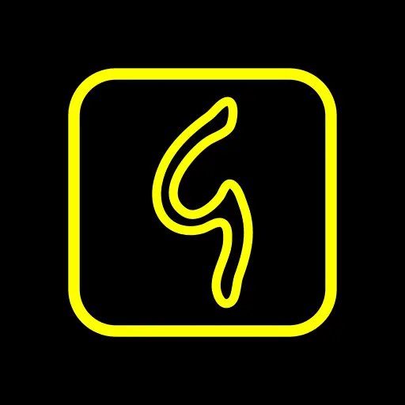

<div align="center">



# 白い熊 GNU Gauguin

**A KenKen-style calculation puzzle, rebuilt in pure black and pure yellow.**

A fork of [Gauguin](https://github.com/meikpiep/gauguin) with **major additions**: a black-and-yellow look with a hundred settable colour roles that survives every upstream release, a full Japanese translation with an in-app language choice, a menu button that answers at once, a Diagnostics section, a category backup written as one timestamped ZIP, and an automation contract that lets a sister app export the state without touching the screen — and back the app's data up and put it back on a wiped phone.

Installs **side-by-side** with upstream Gauguin (app id `shiroikuma.gauguin`).

**📥 Latest release: [`0.53.4+015`](https://github.com/ShiroiKuma0/shiroikuma-gauguin/releases/latest)** — [all releases & APK downloads »](https://github.com/ShiroiKuma0/shiroikuma-gauguin/releases)

</div>

---

## 🎛 The 白い熊 GNU Gauguin UI page

One page owns the entire look of the app. It opens with a thick pill to the app's own settings and a **chip index**: one chip per section, each with its icon in the section's colour. Tap a chip to jump, drag it to reorder the sections. Every section folds, and the fold state and the order are remembered and travel in the export.

Inside are **101 colour roles in 19 sections** — every kind of text, frame, ground, icon, divider and control state has a role of its own, with a reset per role and one for all — plus the fonts, sizes, border thicknesses and corner radii. Colour rows open a picker with A/R/G/B sliders, a live hex readout and swatches of the colours you have already chosen. Font rows list the built-in families plus every `.ttf`/`.otf` you import, **each row rendered in its own glyphs**.

A long-press on the main screen's menu button opens the page directly.

---

## 🟡 Black and yellow, everywhere — and rebase-proof

Black surfaces, `#FFFF00` text and frames, never Material's amber: the **board**, the **keypad**, the **top panel**, the **navigation drawer**, the **bottom bar**, every **menu**, every **dialog** and the **settings**.

Buttons are outlined pills, never filled; switches are outlined pills with a dot; popup menu rows are full-width pills with their icon inside; every settings row carries an icon coloured by what the row does.

Upstream's layouts are not edited for any of it. A theme overlay points upstream's colour attributes at role colours, a resources loader feeds the stored values in at run time, and the widgets are drawn as they are inflated — so a new upstream release rebases without colour conflicts. One switch turns the look off and shows upstream's Material themes.

---

## 🌐 Japanese, and a language of the app's own

Upstream has no Japanese translation; this fork carries a **full one** — the game, the settings, and every string the fork adds.

The UI page's first section is **App language**: the 24 languages the app ships, each written in its own language with its region and tag, the current one in a pill. The choice applies at once, to this app only, travels in the export, and is put back at every start.

---

## 👆 A menu button that answers at once

On a phone with gesture navigation the system keeps the bottom strip of the screen for itself, and a touch landing there reaches an app about 300 ms late — measured on the phone, with raw touch recordings. Gauguin's bottom bar lies inside that strip.

So the menu button is lifted out of the bar and sits right above its left end; the bar and its other buttons stay. A tap opens the drawer, a long-press opens the UI page, and the long-press is timed from the moment the finger landed.

---

## 🩺 Diagnostics

A section of the UI page where every diagnostic has its own switch, all off by default. Files go to the app's own directory, one per kind per day; the section shows what is stored, keeps it for as many days as you choose, exports it to a directory you pick, shares it, or purges it behind a warning. While anything records, a notification says so.

---

## 🔲 A grid as large as the screen

On a large upright screen the number pad sits below the grid rather than beside it, and the cell-size cap is lifted to 240 dp, so the board fills an unfolded screen.

---

## 💾 Export / Import

A section of the UI page. Pick a backup directory — the row stays **red until one is set** — then export any subset of categories as one timestamped ZIP, `shiroikuma-gauguin_<yyyy-MM-dd_HH-mm-ss>.zip`, written atomically through a `.part` file so a half-written backup can never be mistaken for a good one.

Import merges a backup back in key by key, skipping anything it does not recognise, and offers to restart the app so the restored look takes effect at once.

---

## 🤖 The 保存復元 automation contract

Three broadcast actions — `EXPORT_STATE`, `LIST_CATEGORIES`, `CANCEL_EXPORT` — let a sister app drive a backup with no UI at all, and a content provider lets one back the app's **data** up and put it back.

The switch is **on out of the box** and the token is optional, because the case this exists to serve is a phone that has just been wiped, where nothing has been configured and nobody has pasted a secret anywhere. Turning 「Use authorization token?」 on restores the old behaviour; the token row appears only while it is being asked for, and a token sent to the app while it is not is ignored rather than refused.

The data door does not take the app's word for who is calling. The caller is identified by the framework and checked three ways — an **exact** package name, a uid cross-check the kernel answers, and a **pinned signing certificate** — because a package name can be taken freely while the real package is missing, which is exactly the state a clean phone is in. The backup travels through a file descriptor the caller opens, not a path: a descriptor is a capability that expires when it is closed, and it lets the caller encrypt and checksum the archive as its own file. Restoring is reachable **only** here, never as a broadcast.

The receiver itself only gates and hands off: the export runs in a foreground service, because a broadcast's window cannot be stretched to cover it. Every request gets **exactly one terminal reply**, guarded against duplicates; progress broadcasts carry real counts and the category id rather than a percentage; a missing storage grant is reported by checking the grant, not by failing.

---

## 📦 Side-by-side, and honest version numbers

The app id is `shiroikuma.gauguin`, so it installs alongside official Gauguin without touching it. Versions read `<upstream version>+<NNN>` — `0.53.4+001` is the first fork build on top of upstream's 0.53.4 — and the upstream base is read straight out of upstream's manifest, so it can never drift from what the fork is actually built on. The counter is zero-padded, so release lists and file managers sort in build order.

The launcher mark is black-and-yellow line art, and the app's name, links and issue tracker point at this fork rather than upstream.

---

## Built on Gauguin

A fork of [Gauguin](https://github.com/meikpiep/gauguin) by Meik Piepmeyer. Gauguin is a polished, ad-free, FOSS take on the KenKen family of calculation puzzles — the grid generation, the human-style solver that rates a grid's difficulty, the statistics and the game itself are all its work, and that is where the credit belongs. This fork only changes how it looks and what it can hand to an automation tool. The code remains under [GPLv3](https://www.gnu.org/licenses/gpl-3.0).

Upstream lives on [F-Droid](https://f-droid.org/packages/org.piepmeyer.gauguin/) and [Google Play](https://play.google.com/store/apps/details?id=org.piepmeyer.gauguin) — if you like the game, that is where to support it.

## Building

```bash
git clone git@github.com:ShiroiKuma0/shiroikuma-gauguin.git
cd shiroikuma-gauguin

# Signed release APK (needs a keystore.properties at the repo root)
JAVA_HOME=/usr/lib/jvm/java-21-openjdk-amd64 ./gradlew :gauguin-app:assembleRelease

# Or the fork build: signed release, copied to ~/tmp, build counter bumped
JAVA_HOME=/usr/lib/jvm/java-21-openjdk-amd64 ./gradlew buildFork
```

JDK 21, Android SDK 37, Gradle 9.7.0, AGP 9.4.1. No native code, so the APK is universal.

## Art & font licences

Carried over from upstream, and unchanged by this fork:

- **Inter** — designed by Rasmus Andersson, under the Open Font License ([homepage](https://rsms.me/inter), [project](https://github.com/rsms/inter)).
- **'The Siesta' by Paul Gauguin** — from the [Metropolitan Museum of Art](https://www.metmuseum.org/art/collection/search/436449), public domain.
- **Signature of Paul Gauguin** — from [WikiMedia](https://commons.wikimedia.org/wiki/File:Gauguin_autograph.png), public domain in many countries, the author having died in 1903.
